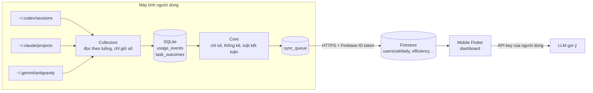

# Kiến trúc

## Phân chia lưu trữ (ADR-0001)

| Nơi lưu | Dữ liệu | Lý do |
|---|---|---|
| SQLite trên desktop | `source_files`, `sessions`, `usage_events`, `task_outcomes`, `daily_local`, `sync_queue`, `pricing` | Dữ liệu chi tiết, nhiều dòng; cần SQL để tính P50/P90, khoảng tin cậy; không rời máy |
| Firestore | `users/{uid}`: `connections`, `pairing`, `sync_requests`, `daily/{date}`, `efficiency/current`, `recommendations`, `budget`, `budget_alerts`; `pricing/` | Chỉ số liệu tổng hợp; ~2 lượt ghi mỗi lần sync, vừa hạn mức gói Spark |
| Android Keystore | API key LLM | Không bao giờ rời điện thoại |

## Luồng xử lý trên desktop

1. `Collectors` theo dõi thư mục log, đọc phần mới từ `read_offset`, giải nén `.zst`.
2. Chuẩn hóa token (SRS §10.4), gộp trùng theo khóa nguồn, ghi `usage_events`.
3. Gom turn thành task, suy ra `outcome_state`, ghi `task_outcomes`.
4. Tính lại document ngày hôm nay và `efficiency/current`, đánh dấu `dirty`.
5. Theo chu kỳ sync (hoặc khi có `sync_requests`), đẩy các document `dirty` qua `sync_queue`.
